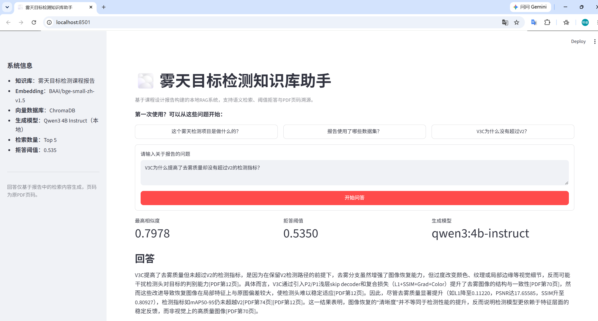
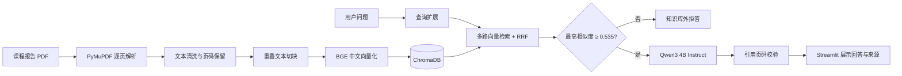

# Fog Detection RAG Assistant

面向雾天目标检测课程报告的本地 RAG（Retrieval-Augmented Generation）知识库助手。系统能够解析 PDF、建立中文向量索引、回答报告相关问题，并给出可核查的原 PDF 页码；对于与报告无关的问题，会根据检索相似度主动拒答。

本项目将一份 116 页的雾天目标检测实验报告转化为可交互知识库，重点展示一条完整、可复现的 RAG 工程链路，而不是只调用一次大模型接口。

## 界面演示



示例问题围绕 V3C 去雾质量与检测性能的差异展开。页面同时展示最高检索相似度、拒答阈值、本地生成模型、带 PDF 页码的回答以及可展开的 Top K 检索依据。

## 项目亮点

- **完整 RAG 链路**：PDF 解析、文本清洗、重叠切块、向量化、检索、生成、引用校验和 Web 交互。
- **保留来源信息**：每个文本块记录原 PDF 页码，回答可回溯到实验报告。
- **中文语义检索**：使用 `BAAI/bge-small-zh-v1.5` 生成 512 维文本向量，并由 ChromaDB 持久化存储。
- **增强模糊问题检索**：对“用了什么数据集”等口语化问题进行查询扩展，并通过多路召回与 RRF 融合结果。
- **阈值拒答**：根据自建评测集确定相似度阈值，避免系统强行回答旅行商、动态规划等知识库外问题。
- **完全本地运行**：通过 Ollama 调用 `qwen3:4b-instruct`，无需付费 API，原始报告与向量库均留在本机。
- **引用约束**：生成后校验页码，只保留本次检索结果中真实存在的 PDF 页码。

## 系统架构



离线阶段负责把报告转换成可搜索的向量知识库；在线阶段只对用户问题做检索与生成，因此同一知识库可以被重复使用。

## 当前效果

报告共 116 页。跳过封面和目录后，系统保留 113 页正文并生成 244 个带页码的文本块。

在 15 条可回答问题和 4 条知识库外问题组成的自建评测集上，当前检索结果如下：

| 指标 | 结果 |
| --- | ---: |
| Hit@1 | 0.5333 |
| Hit@3 | 1.0000 |
| Hit@5 | 1.0000 |
| MRR@5 | 0.7556 |
| 可回答问题最低相似度 | 0.5512 |
| 知识库外问题最高相似度 | 0.5190 |
| 当前拒答阈值 | 0.5350 |

例如，系统能够解释“V3C 为什么没有超过 V2”，引用报告中的实验指标及原因分析；对于“如何使用动态规划解决旅行商问题”，系统会判断其超出当前报告范围并拒绝作答。

> 这里的评测集规模仍然较小，指标用于验证 MVP 检索链路是否有效，不代表通用问答能力。

## 技术栈

| 模块 | 方案 |
| --- | --- |
| PDF 解析 | PyMuPDF |
| Embedding | BAAI/bge-small-zh-v1.5 |
| 向量数据库 | ChromaDB |
| 检索策略 | 余弦相似度、查询扩展、RRF |
| 本地大模型 | Qwen3 4B Instruct + Ollama |
| 前端 | Streamlit |
| 评测 | Hit@K、MRR@5、正负样本相似度分析 |

## 目录结构

```text
fog-detection-rag-assistant/
├─ app.py                              # Streamlit Web 入口
├─ src/
│  ├─ parse_pdf.py                    # PDF 解析与文本清洗
│  ├─ chunk_text.py                   # 重叠切块并保留页码元数据
│  ├─ build_index.py                  # 生成向量并写入 ChromaDB
│  ├─ search.py                       # 查询扩展、多路检索与 RRF
│  └─ rag.py                          # 阈值拒答、答案生成与引用校验
├─ evaluation/
│  ├─ retrieval_questions.jsonl       # 人工标注的检索问题与目标页码
│  ├─ evaluate_retrieval.py           # 检索评测脚本
│  └─ retrieval_results.json          # 完整评测结果
├─ data/
│  └─ README.md                       # 本地报告放置说明
├─ assets/                            # README 截图与演示素材
├─ .streamlit/config.toml             # Streamlit 稳定性配置
├─ .env.example                       # 环境变量示例
└─ requirements.txt
```

原始 PDF、清洗后的文本块和 ChromaDB 均属于本地产物，已通过 `.gitignore` 排除，不会上传至 GitHub。

## 本地运行

以下命令以 PowerShell 为例。推荐使用 Python 3.11。

### 1. 克隆项目并安装依赖

```powershell
git clone https://github.com/yoke-tmr/fog-detection-rag-assistant.git
cd fog-detection-rag-assistant

python -m venv .venv
.\.venv\Scripts\Activate.ps1
python -m pip install -r requirements.txt
```

### 2. 准备本地模型

安装并启动 [Ollama](https://ollama.com/)，然后下载项目使用的指令模型：

```powershell
ollama pull qwen3:4b-instruct
ollama run qwen3:4b-instruct
```

能够完成一次中文问答后，输入 `/bye` 退出交互测试。Ollama 服务需要在运行 RAG 时保持启动。

### 3. 配置环境变量

```powershell
Copy-Item .env.example .env
```

默认配置已经对应当前 MVP：

```dotenv
LLM_PROVIDER=ollama
LLM_BASE_URL=http://localhost:11434
LLM_MODEL=qwen3:4b-instruct
EMBEDDING_MODEL=BAAI/bge-small-zh-v1.5
CHROMA_PERSIST_DIR=chroma_db
TOP_K=5
SIMILARITY_THRESHOLD=0.535
```

### 4. 构建知识库

将自己的 PDF 放入 `data/` 并命名为 `main.pdf`，然后依次执行：

```powershell
python .\src\parse_pdf.py
python .\src\chunk_text.py
python .\src\build_index.py
```

三个步骤分别负责逐页提取与清洗、生成带重叠的文本块、建立本地向量索引。首次运行会从 Hugging Face 下载 Embedding 模型。

### 5. 运行检索评测

```powershell
python .\evaluation\evaluate_retrieval.py
```

评测脚本会输出逐题命中情况、Hit@K、MRR@5、正负样本相似度分布和候选拒答阈值，并将完整结果保存到 `evaluation/retrieval_results.json`。

### 6. 启动 Web 界面

```powershell
python -m streamlit run app.py
```

浏览器打开终端给出的本地地址后，可以直接提问，也可以使用页面上的示例问题。回答下方可展开查看命中的文本块、相似度和原 PDF 页码。

也可以不启动网页，直接在终端测试：

```powershell
python .\src\rag.py "V3C为什么没有超过V2？"
```

## 关键设计说明

### 为什么使用查询扩展

报告中的原文可能写作“合成雾训练集、验证集与 RTTS”，而用户更可能问“文中用了什么数据集”。单次向量检索容易因表达差异漏掉目标页面，因此系统为部分宽泛问题生成若干检索表达，再使用 RRF 合并排名。该策略提高了入门型问题的召回率，同时不改变已有问题的评测结果。

### 为什么设置拒答阈值

向量数据库始终会返回若干“最相似”文本，即使问题完全不属于知识库。评测中，可回答问题的最低相似度为 0.5512，知识库外问题的最高相似度为 0.5190，因此 MVP 将阈值设为二者之间的 0.535。低于阈值时不调用大模型，直接说明当前报告无法回答。

### 为什么校验引用

小参数模型可能生成未出现在上下文中的页码。系统会在生成后检查引用，仅允许输出本轮 Top K 检索结果对应的原 PDF 页码，降低引用幻觉风险。

## 已知局限与后续计划

- 当前知识库只包含一份课程报告，适合演示垂直领域 RAG，不具备通用问答能力。
- 拒答阈值来自 19 条小规模人工评测数据，后续需要扩充同义问法、困难负样本和跨章节问题。
- 当前采用稠密向量检索，可进一步加入 BM25 与 Cross-Encoder 重排，比较混合检索的收益。
- 回答生成使用本地 4B 模型，复杂归纳能力和生成速度受设备性能限制。
- 可继续增加流式输出、对话历史、PDF 在线上传和 Docker 部署。

## 隐私说明

请勿直接提交包含姓名、学号、电话、组员信息或其他隐私内容的原始报告。本项目默认忽略 `data/*.pdf`、`data/processed/*.jsonl`、`chroma_db/` 和 `.env`。

## License

本项目用于学习、课程实践与个人作品展示。若替换为其他文档，请确认自己拥有相应文件的使用与公开权限。

